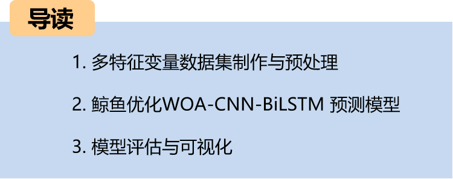
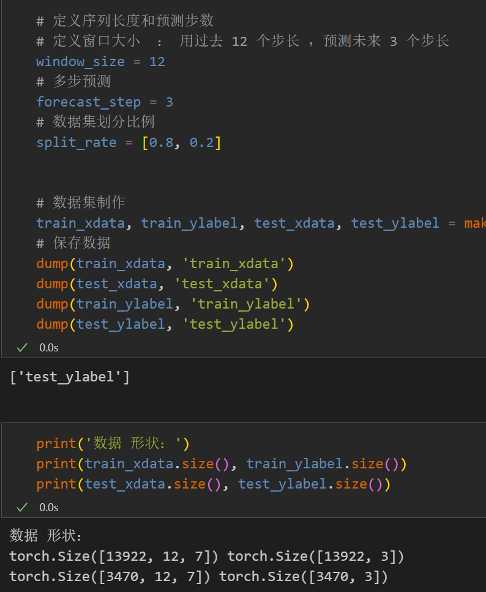
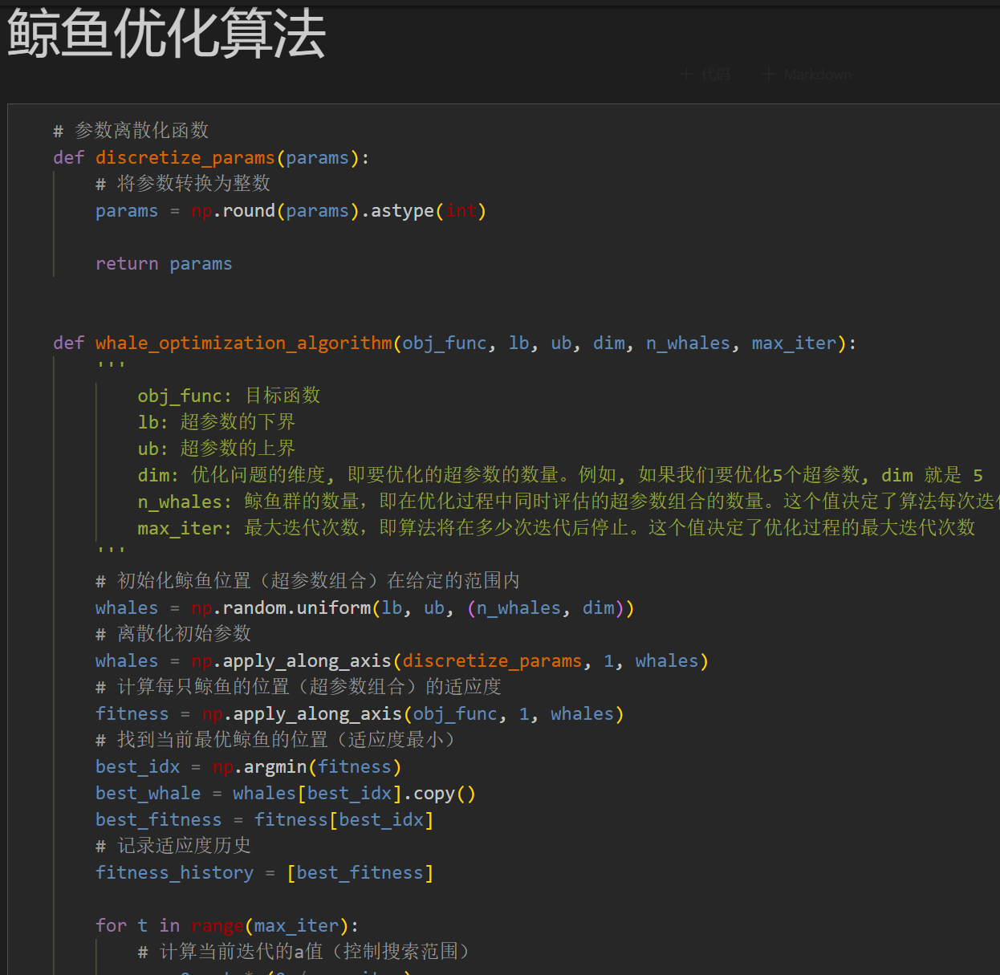
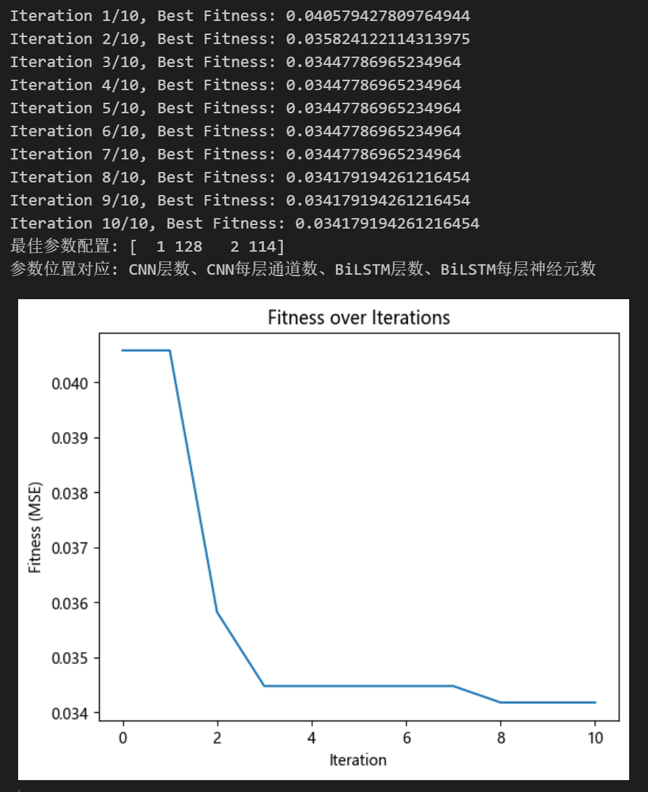
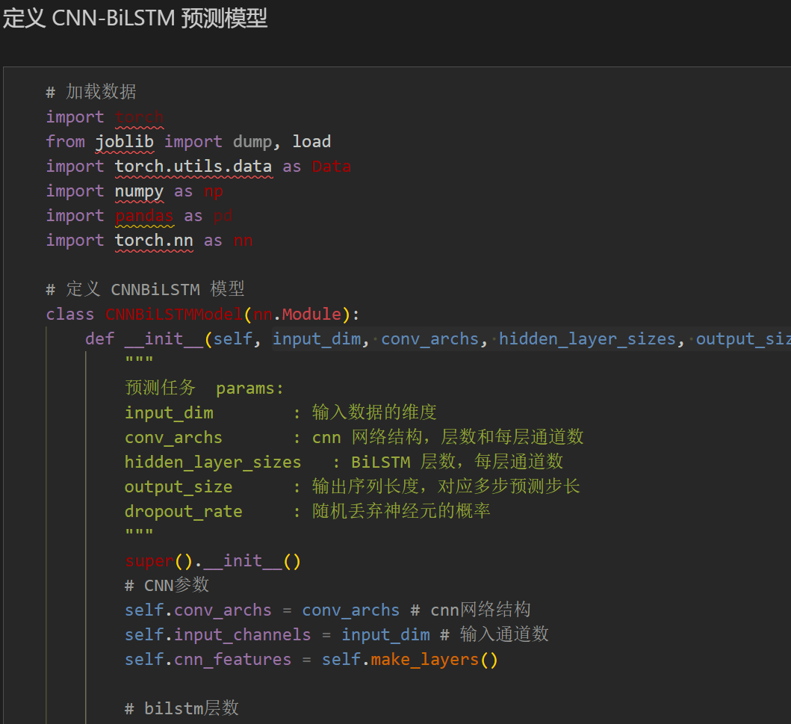
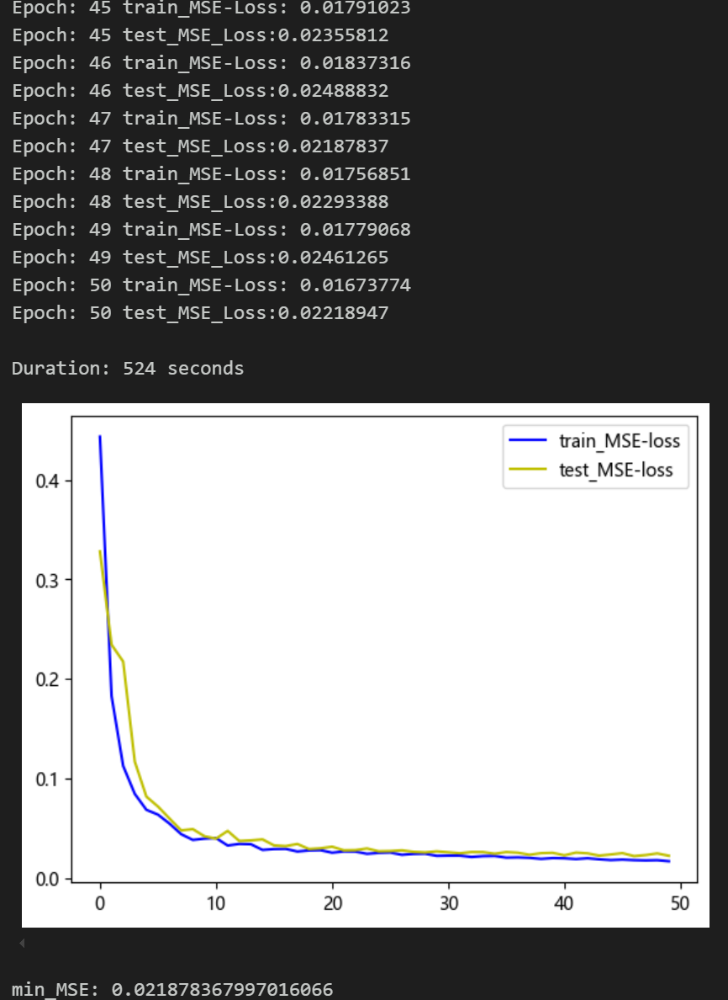
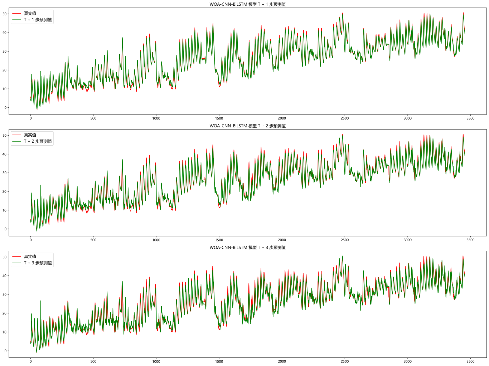
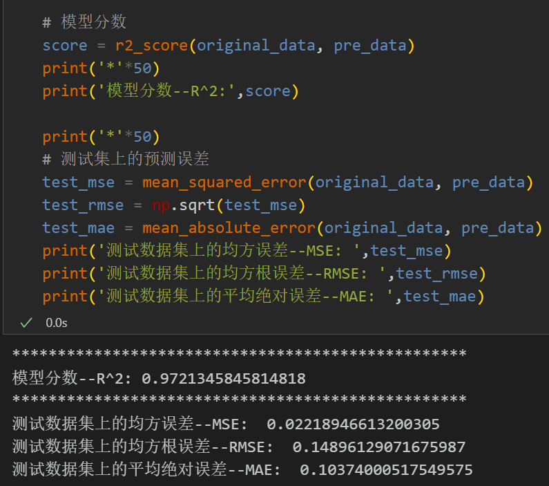
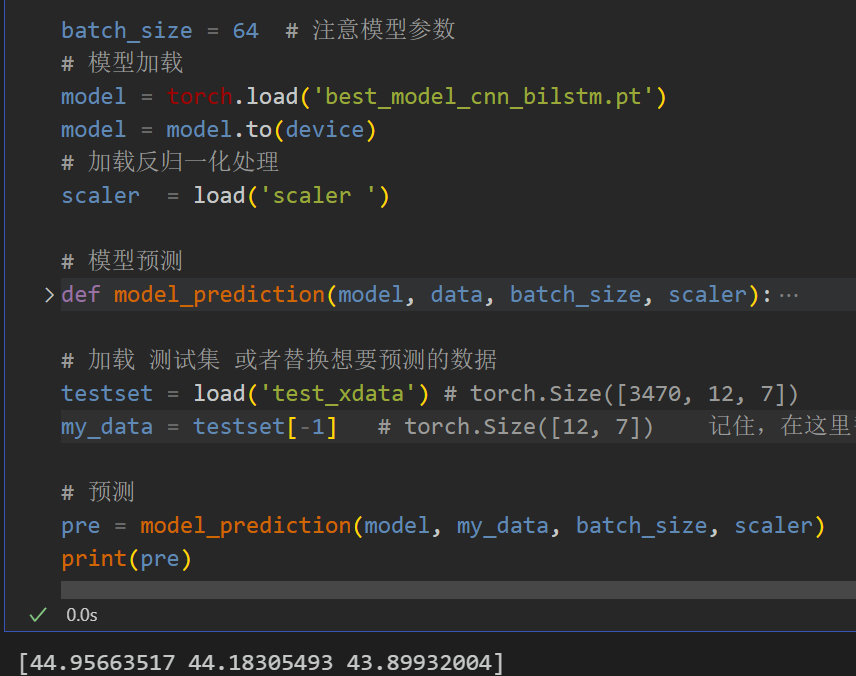
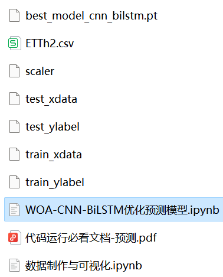

# WOA-CNN-BiLSTM Multi-Step Prediction Model Based on Whale Optimization Algorithm

1. Data Set: Wind Speed Data Set and Electric Power Transformer Data Set!
2. Environment Framework: Python 3.9, PyTorch 1.8 or above are all compatible for running.
3. Usage Objects: Those who need papers or graduation projects.
4. Code Guarantee: The code is detailed with comments, ready to run without modification.
Preface
This article introduces a WOA-CNN-BiLSTM multi-feature multi-step prediction model based on the electric power transformer (mentioned in the end of the paper) to improve the predictive performance of time series data. The core of this method is to use the whale optimization algorithm to search and optimize the parameters of the CNN-BiLSTM model to achieve precise predictions. For more details about the electric power transformer data set, please refer to the following text:
Introduction to the Electric Power Transformer Data Set and Preprocessing
1. Visualization of the Data Set
1.1 Importing Data
1.2 Making the Data Set
1.3 Division of the dataset into training set and test set at an 8:2 ratio
2. Whale Optimization Algorithm
2.1 Introduction to the Whale Optimization Algorithm
The Whale Optimization Algorithm (WOA) is a heuristic optimization algorithm proposed by Seyedali Mirjalili and Andrew Lewis in 2016, inspired by the hunting behavior of humpback whales, especially their "bubble net" attack strategy when hunting.
The basic principle of the Whale Optimization Algorithm simulates three main behaviors of humpback whales when hunting:
1. Surrounding prey:
Humpback whales will spiral up or down around their prey.
2. Bubble net attack method:
Humpback whales form bubble nets around their prey through spiral movements.
3. Random searching for prey:
Humpback whales swim randomly to search for prey.
2. Implementation of the Whale Optimization Algorithm Based on Python
2.3 Whale Optimization Algorithm - Superparameter Optimization Process
\t  
The Whale Optimization Algorithm is an heuristic optimization algorithm inspired by the hunting behavior of humpback whales in nature. By simulating the behaviors of whales around prey, bubble net attacks, and random searches, this algorithm can effectively find the optimal solution within the search space. We use the Whale Optimization Algorithm to optimize the hyperparameters of the CNN-BiLSTM model. By setting the appropriate number of whales and the number of optimization iterations, we search for the optimal parameters within the given hyperparameter range.
3. CNN-BiLSTM Multi-Step Prediction Model Based on WOA
\t3.1 Define the CNN-BiLSTM prediction model
3.2 Set parameters and train the model
50 epochs, MSE is 0.0218, WOA-CNN-BiLSTM prediction effect is good, appropriately adjust the model parameters, can further improve the model prediction performance.
\tNote: Adjust parameters.
The whale optimization algorithm can be modified by adjusting the number of whales and the number of optimization iterations.
Adjust the parameter search range for the number of layers and dimensions in CNN and BiLSTM, increase more epochs (note to prevent overfitting)
\tThe sliding window length can be changed (set the appropriate window length).
3.3 Model Evaluation
\tVisualization of prediction results
Model Evaluation:
\t3.4 Forecasting
\t  
Click to download: Complete original data, Python code
Previously Featured Content:
Time Series Forecasting: Analysis and comparison of LSTM, ARIMA, Holt-Winters, SARIMA models
Wind Speed Prediction (Part 1) Data Set Introduction and Preprocessing
Wind Speed Prediction (II) EMD-LSTM Model Based on Pytorch
Wind Speed Prediction (III) EMD-LSTM-Attention Model
Wind Speed Prediction (IV) EMD-Transformer Model Based on Pytorch
Wind Speed Prediction (5) EMD-CNN-LSTM Model Based on PyTorch
Wind Speed Prediction (6) EMD-CNN-GRU Parallel Model Based on PyTorch
CEEMDAN + Combination Prediction Model (BiLSTM-Attention + ARIMA)
CEEMDAN + Combination Prediction Model (CNN-LSTM + ARIMA)
CEEMDAN + Combination Prediction Model (Transformer - BiLSTM + ARIMA)
CEEMDAN + Combination Prediction Model (CNN-Transformer + ARIMA)
Multi-Feature Variable Sequence Prediction (1) - CNN-LSTM Wind Speed Prediction Model
Multi-Feature Variable Sequence Prediction (2) - CNN-LSTM-Attention Wind Speed Prediction Model
Multi-Feature Variable Sequence Prediction (3) - CNN-Transformer Wind Speed Prediction Model
Multi-Feature Variable Sequence Prediction (4) - Transformer-BiLSTM Wind Speed Prediction Model
Multi-Feature Variable Sequence Prediction (5) - CEEMDAN+CNN-LSTM Wind Speed Prediction Model
Multi-Feature Variable Sequence Prediction (6) - CEEMDAN+CNN-Transformer Wind Speed Prediction Model
Prediction Model Based on SSA Optimized by Sparrow - CEEMDAN-BiLSTM-Attention
Prediction Model Based on SSA Optimized by Sparrow - CEEMDAN-Transformer-BiGRU
Superior Prediction Model: Secondary Decomposition-Combination Prediction
Multi-Feature Variable Sequence Prediction (7) - CEEMDAN+Transformer-BiLSTM Prediction Model
Multi-Feature Variable Sequence Prediction (8) - Prediction Model Based on SSA Optimized by Sparrow - CEEMDAN-SSA-BiLSTM Prediction Model
Multi-feature variable sequence prediction (11) - PyTorch TCN-GRU prediction model based on VMD + CEEMDAN 
VMD + CEEMDAN secondary decomposition, CNN-LSTM prediction model 
VMD + CEEMDAN secondary decomposition, CNN-Transformer prediction model 
Prediction model based on the SSA of the Sparrow Optimization Algorithm - complete code kit 
Introduction to and preprocessing of power transformer datasets 
\t2. Friends who like this can click to follow, give the article a "like", share in the circle or discuss in groups

## Images

<!-- PAYMENT_BLOCK -->

## Get this dataset

- Payment link (Stripe): [Buy now](https://buy.stripe.com/3cs8yP7sY87d0vu9AB)
- Payment QR code: 

<!-- /PAYMENT_BLOCK -->
